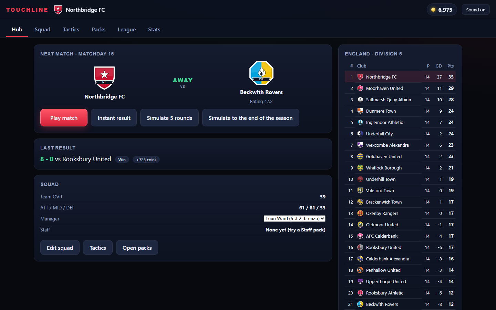
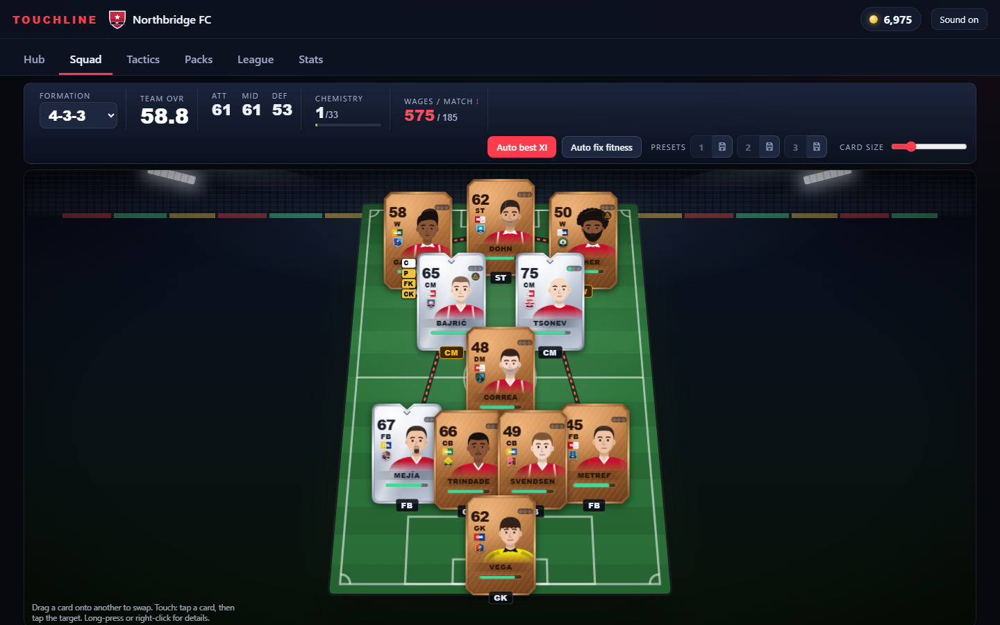
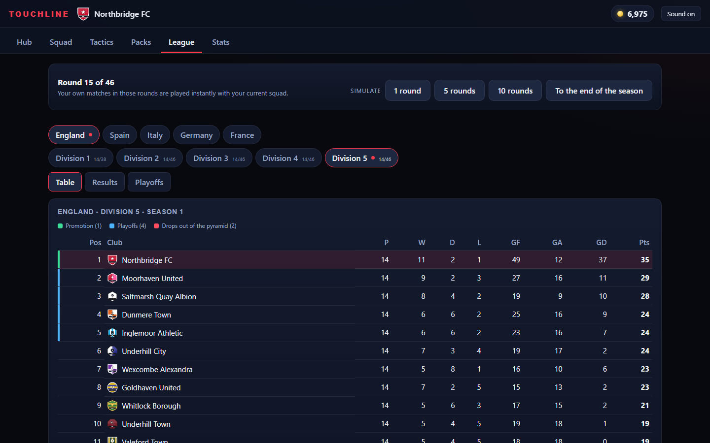
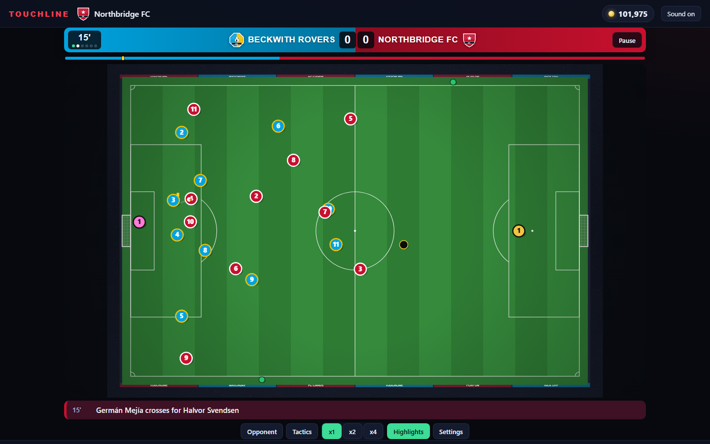
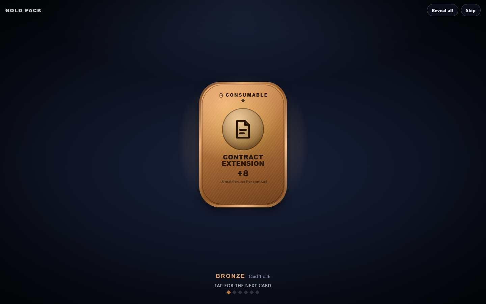
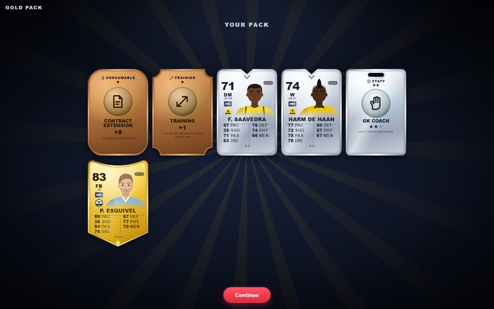
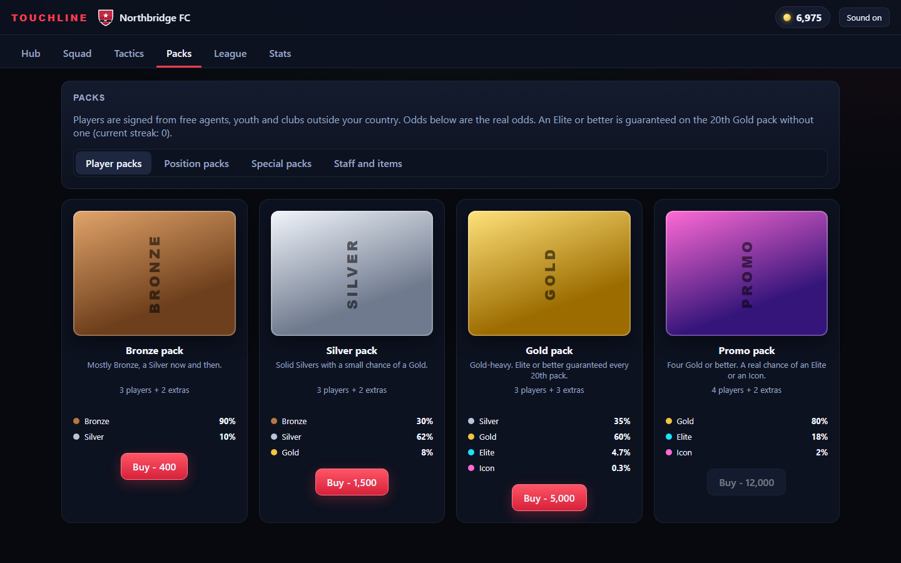
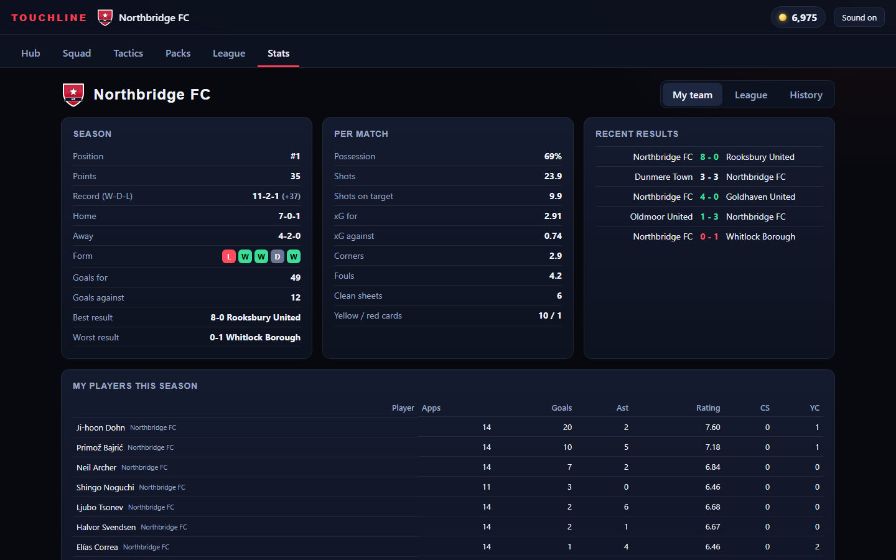

# Touchline

Single-player browser football card manager. Open a pack, build a squad, set tactics, and climb a 5-level league pyramid across 5 countries. Everything runs offline in one HTML file. All people, clubs and sponsors are fictional.

Play: https://underscoreloG.github.io/touchline/

Status: playable demo. The game autosaves to your browser (IndexedDB) after every change. The main page has Continue, Reset, and Export / Import file buttons; the Menu button in the top bar takes you back to it. Clearing site data deletes the save, so use Export for a backup.

## Screenshots

| | |
|---|---|
|  |  |
| Hub: next match, form table, quick links | Squad: 3D pitch, formations, drag and drop |
|  |  |
| League pyramid: 5 countries x 5 levels, promotion and playoff zones | Live match: 2D top-down view, commentary, touchline shouts |
|  |  |
| Pack opening | Pack summary: players, staff, training and consumables |
|  |  |
| Pack shop: 12 pack types | Stats: my team, the league, history |

Regenerate them with `node tools/build.js && node tools/shots.js` (needs Chrome or Edge).

## Build

    npm ci
    node tools/build.js      # writes dist/index.html (standalone, about 2.6 MB)
    node tools/serve.js 5400 # then open http://localhost:5400/dist/index.html

Checks: `node tools/check-league.js`, `check-game.js`, `check-squad.js`, `check-packs.js`, `sim.js --n 3000`. See `HANDOFF.md` for the design notes and open work.

## Credits

Sounds are real recordings: Kenney (CC0), qubodup (CC0) and Gregor Quendel's Free Crowd Cheering Sounds (CC BY 4.0). Details in `src/assets/sounds/LICENSES.md`.
